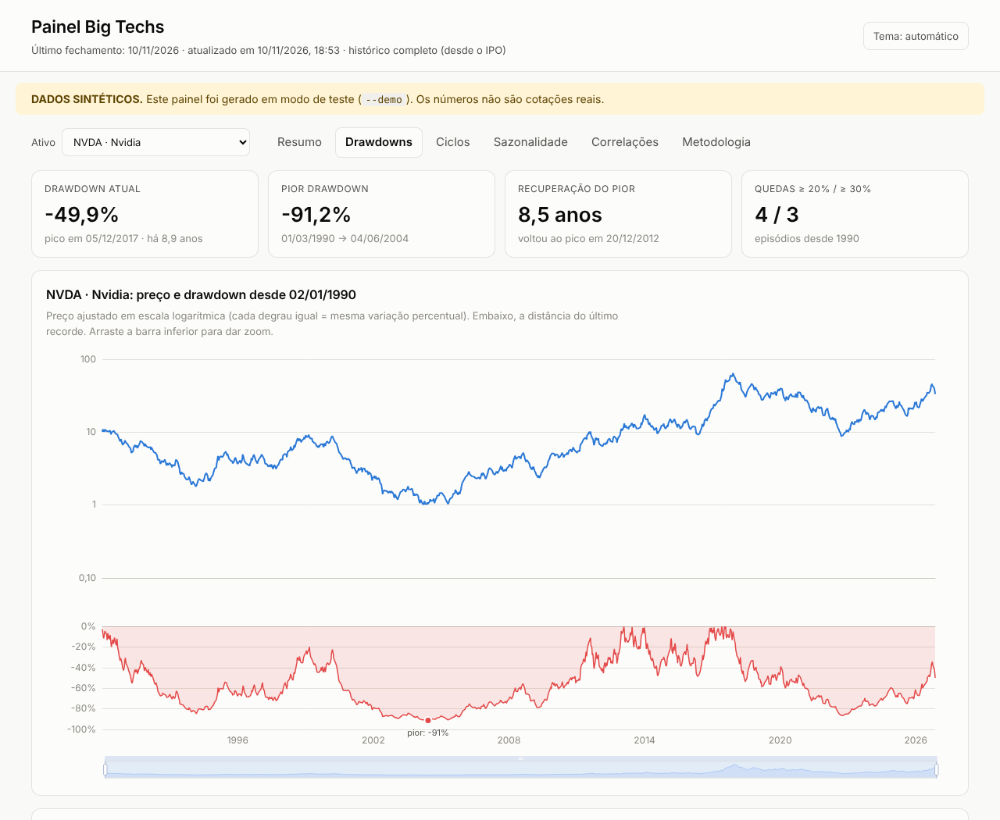

# Painel Big Techs

Site gratuito, que se atualiza sozinho, com o **histórico completo** (desde o IPO) das big techs e de ações de IA e computação:

- **Drawdowns:** distância do recorde, as maiores quedas da história, o tempo de queda e o tempo de recuperação.
- **Ciclos:** fases de alta e baixa pela regra de 15%, 20% ou 30%; duração e retorno típicos; onde a fase atual está em relação às anteriores; retorno móvel de 12 meses e de 3 anos.
- **Sazonalidade:** tabela ano a ano **mensal, bimestral e trimestral**, com média, mediana e % de vezes positivo, em retorno absoluto ou contra uma referência (QQQ, SPY, SMH). Inclui o filtro "desde o ano X".
- **Correlações:** matriz por janela (1, 3, 5 e 10 anos, ou todo o período), correlação móvel com as referências e a **correlação média entre as big techs**, um termômetro de "comportamento de manada".



> As imagens deste README foram geradas com **dados sintéticos** (`--demo`). O site publicado usa cotações reais.

---

## Como colocar no ar (cerca de 15 minutos, tudo grátis)

Você só precisa de uma conta gratuita no [GitHub](https://github.com).

### Opção A: pelo navegador, sem instalar nada

1. No GitHub, clique em **New repository**. Use o nome `painel-bigtechs`, marque **Public** e clique em **Create repository**.
2. Na página do repositório vazio, clique em **uploading an existing file**. Arraste **todo o conteúdo** desta pasta (`config.json`, `requirements.txt`, `README.md` e as pastas `scripts`, `site` e `docs`) e clique em **Commit changes**.
3. A pasta `.github` costuma ficar oculta no computador, então crie o arquivo de automação à mão:
   **Add file → Create new file**. No nome, digite `.github/workflows/atualizar.yml`. Cole o conteúdo do arquivo de mesmo nome deste pacote (abra-o num editor de texto) e clique em **Commit changes**.
4. Vá em **Settings → Pages**. Em **Build and deployment → Source**, escolha **GitHub Actions**.
5. Vá na aba **Actions**. Se aparecer um aviso, clique para ativar os workflows. Abra **Atualizar dados e publicar** e clique em **Run workflow**.
6. Depois de 3 a 5 minutos, o endereço aparece em **Settings → Pages**:
   `https://SEU-USUARIO.github.io/painel-bigtechs/`

### Opção B: com git (se você já usa)

```bash
cd painel-bigtechs
git init -b main
git add .
git commit -m "Painel Big Techs"
git remote add origin https://github.com/SEU-USUARIO/painel-bigtechs.git
git push -u origin main
```

Depois siga os passos 4 a 6 da opção A.

---

## Como funciona a atualização automática

Todo dia útil às 19h17 de Brasília, o GitHub Actions baixa as cotações, confere, guarda na base, recalcula os indicadores e publica o site. Cada execução mostra a tabela **Saúde dos dados** na aba Actions.

As cotações vêm de até três fontes, tentadas nesta ordem para cada ativo:

| Fonte | Papel | Precisa de chave? |
|---|---|---|
| Yahoo Finance | Principal. Histórico completo. | Não |
| Tiingo | Reserva de histórico completo (50 chamadas por hora). | Sim: segredo `TIINGO_API_KEY` |
| Twelve Data | Reserva que completa os últimos pregões (800 chamadas por dia). | Sim: segredo `TWELVEDATA_API_KEY` |

Se todas falharem, o site usa a base salva e avisa no topo da página. Se menos da metade dos ativos tiver dados, o site não é alterado.

### Chaves gratuitas (opcionais, recomendadas)

1. **Tiingo:** crie a conta em tiingo.com, copie o token em *Account → API → Token*.
2. **Twelve Data:** crie a conta em twelvedata.com, copie a chave em *API Keys*.
3. No repositório: **Settings → Secrets and variables → Actions → New repository secret**. Crie `TIINGO_API_KEY` e `TWELVEDATA_API_KEY` com os valores copiados.

### Logotipos (opcional)

Crie a conta em logo.dev, copie a **publishable key** (`pk_...`) e cole em `config.json`, no campo `logo_dev_token`. Essa chave é feita para ficar visível no site. Sem ela, aparecem as iniciais do ticker. O plano gratuito pede o crédito "Logos provided by Logo.dev", que o site já põe no rodapé.

### Backup versionado da base (opcional)

1. Crie um repositório **privado** chamado `MercadoFinBigTech-dados` (o nome deste repositório + `-dados`), com um README.
2. Em *Settings (da sua conta) → Developer settings → Fine-grained tokens*, gere um token com acesso só a esse repositório e permissão **Contents: Read and write**.
3. Salve o token neste repositório como segredo `DADOS_TOKEN`.

## Adicionar ações, segmentos e mercados

Os ativos ficam em `universo/`. Para incluir uma ação, acrescente uma linha no segmento desejado de `universo/eua.json`:

```json
{"id": "NFLX", "nome": "Netflix"}
```

Para criar um segmento, acrescente um bloco em `segmentos` com `id`, `nome` e `ativos`. Detalhes e as outras receitas estão em `docs/ARQUITETURA.md`.

`config.json` guarda só as opções gerais:

| Campo | O que faz |
|---|---|
| `title` | Título do site. |
| `start` | `"max"` (desde o IPO) ou uma data, ex.: `"2000-01-01"`. |
| `cycle_thresholds` | Limiares da regra de ciclos. |
| `logo_dev_token` | Chave publicável da Logo.dev. |

## Ver no seu computador (opcional)

```bash
pip install -r requirements.txt
python scripts/build_data.py           # dados reais
# ou: python scripts/build_data.py --demo   (dados sintéticos, só para ver o visual)
python -m http.server 8000 -d site
```

Depois, abra `http://localhost:8000`. Abrir o `index.html` com duplo clique não funciona, porque o navegador bloqueia a leitura dos arquivos de dados direto do disco.

## Compartilhar

O endereço do GitHub Pages é público. Os links guardam a aba e o ativo, por exemplo:
`https://SEU-USUARIO.github.io/painel-bigtechs/#aba=ciclos&ativo=NVDA`

---

## Sobre os dados (leia antes de divulgar amplamente)

- O Yahoo Finance não oferece API oficial. O `yfinance` usa endpoints públicos que podem mudar ou limitar acessos, e os termos do Yahoo falam em **uso pessoal**.
- Este projeto **não guarda as cotações brutas no repositório**: elas ficam só no cache privado do GitHub Actions. O site exibe gráficos e métricas derivadas.
- Para uma página educacional, sem fins comerciais, essa é a prática comum de projetos pessoais. Se quiser **monetizar ou distribuir em larga escala**, use uma fonte licenciada para redistribuição (por exemplo, um plano comercial da Tiingo). Isto não é orientação jurídica.
- Material educacional. Não é recomendação de investimento.

## Estrutura

O desenho do projeto está em `docs/ARQUITETURA.md` e o plano das próximas fases em `docs/ROADMAP.md`.

## Problemas comuns

- **A etapa "Baixar dados" falhou:** o Yahoo pode ter bloqueado temporariamente. Rode de novo mais tarde ou configure a Tiingo.
- **O site dá 404:** confira se **Settings → Pages → Source** está em **GitHub Actions** e se a primeira execução terminou (ícone verde em Actions).
- **A atualização diária parou:** na aba **Actions**, abra o workflow e clique em **Enable workflow**.
- **Um ativo não aparece:** confira se o símbolo existe no Yahoo Finance (pesquise em finance.yahoo.com).
